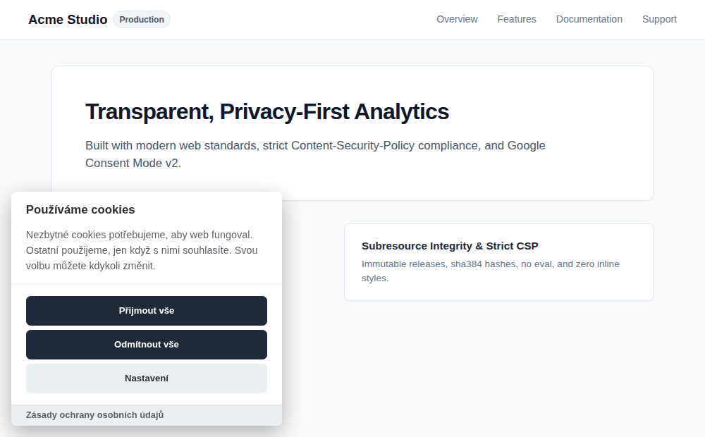
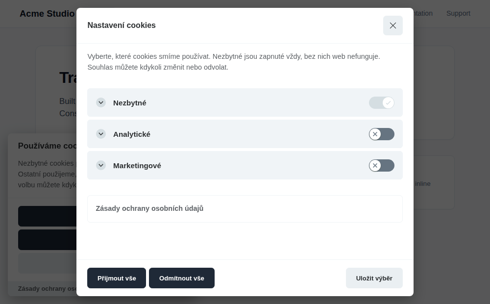
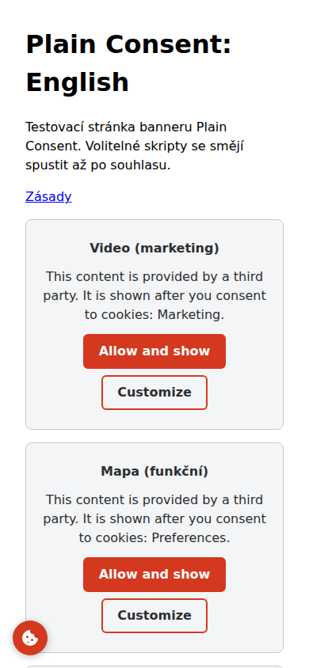

# Plain Consent

A free, lightweight, dependency-free cookie consent banner with Google Consent Mode v2, Subresource Integrity, and strict Content-Security-Policy compliance. Built on [vanilla-cookieconsent](https://github.com/orestbida/cookieconsent) (MIT).

[](LICENSE)

The banner speaks Czech, Slovak, English, German and Polish out of the box (Czech is the default, `"language": "auto"` follows `<html lang>`), and every text is fully configurable so you can translate it into any other language. [Česká verze níže](#česky).

- **Licence:** MIT (see [LICENSE](LICENSE) and [NOTICE](NOTICE))
- **Current release:** [`releases/v2.2.0/`](releases/v2.2.0/)
- **Hosted generator (Czech):** <https://socionet.cz/nastroje/cookie-lista/>

---

## Why Plain Consent?

- **True opt-in without dark patterns.** Nothing optional is pre-enabled. "Accept all" and "Reject all" sit side by side in the first layer with identical styling and equal visual prominence. No cookie wall: visitors who decline non-essential cookies can use the site without hindrance.
- **Lightweight and dependency-free.** Just two files: `plain-consent.js` (65 kB / 23.4 kB gzip, including five languages) and `plain-consent.css` (38 kB / 7.2 kB gzip). Zero runtime dependencies.
- **Google Consent Mode v2 built-in.** Denies all consent parameters (`ad_storage`, `ad_user_data`, `ad_personalization`, `analytics_storage`, `functionality_storage`, `personalization_storage`) by default (`wait_for_update: 500`, `ads_data_redaction: true`) before any Google tag executes. Updates synchronously on consent, and applies a returning visitor's stored choice before Google tags load.
- **Strict Content-Security-Policy friendly.** Zero network requests from the banner, no `eval` or `new Function`, and no inline styles (colors are applied through CSSOM custom properties on the root element). A strict CSP requires only the two file URLs.
- **Subresource Integrity (SRI).** Every release is immutable and cryptographically pinned with sha384 hashes in the embed snippet, guaranteeing that scripts cannot be modified or tampered with.
- **Script management and cookie cleanup.** Tag third-party scripts with `type="text/plain"` and `data-category="analytics"` (or `marketing`, `preferences`) so they only run after consent. When a visitor refuses or withdraws consent, known cookies of major tracking services (Google Analytics, Clarity, Hotjar, Meta Pixel, Google Ads, TikTok, Microsoft Ads, Pinterest) are automatically purged.
- **Embeds wait for consent too (new in 2.1.0).** Tag an `<iframe>` (YouTube, maps, forms) with `data-category` and `data-src` and it loads nothing until its category is accepted. A placeholder explains why and offers "Allow and show"; withdrawing consent unloads the iframe again. See [Embeds](#2b-block-embeds-youtube-maps-forms-until-consent).
- **Five languages built in (new in 2.1.0).** Czech, Slovak, English, German and Polish, chosen with `"language"` or detected from `<html lang>`. Your own `texts` still win.
- **Global Privacy Control (new in 2.1.0).** When the browser sends the GPC signal, marketing is not offered and never granted (Consent Mode keeps `ad_storage`, `ad_user_data` and `ad_personalization` denied), and the settings explain why. Switch off with `"respectGpc": false`.
- **A consent event for your own code (new in 2.1.0).** `document.addEventListener("plain-consent:update", (e) => e.detail.categories)` fires on every choice and on every page load with a stored choice.
- **Frictionless consent withdrawal.** Once a choice is made, an accessible floating settings button appears at the bottom-left, allowing visitors to change or revoke consent at any time as required by GDPR and ePrivacy regulations. You can also trigger settings from your own footer link.
- **Fail-closed, safe configuration.** Configured via a single JSON block. Every text string is HTML-escaped, links are verified (only `http(s)` URLs and same-origin paths allowed), and invalid values safely fall back to defaults so the banner always asks.
- **Built on battle-tested foundation.** Powered by the widely adopted [vanilla-cookieconsent](https://github.com/orestbida/cookieconsent) v3.1.0 engine by Orest Bida.

---

## Preview



Visitors can review and manage individual categories in the preferences modal:



Blocked embeds show a placeholder (here on a phone, in English) and the round settings button stays at the bottom-left:



---

## Quick Start

### 1. Embed the Banner

You can self-host the release files (recommended for v2.2.0) or use the hosted endpoint for v1.0.0.

#### Option A: Self-hosted (Recommended for v2.2.0)

1. Download `plain-consent.js` and `plain-consent.css` from [`releases/v2.2.0/`](releases/v2.2.0/) and place them on your web server (for example at `/plain-consent/v2.2.0/`).
2. Add this snippet inside the `<head>` of your page, **before** all other scripts (especially before the Google tag):

```html
<link rel="stylesheet" href="/plain-consent/v2.2.0/plain-consent.css" integrity="sha384-UigpuEPI8sZ22V7UM8A95UEmcs6VT3cmYC49ue/wrNcQw0Vm9Hf6SsjkLv0C7zlM" crossorigin="anonymous">
<script type="application/json" id="plain-consent-config">
{
  "accent": "#1f2937",
  "categories": ["analytics", "marketing"],
  "privacyUrl": "/privacy/",
  "consentMode": true,
  "credit": false,
  "revision": 0
}
</script>
<script src="/plain-consent/v2.2.0/plain-consent.js" integrity="sha384-49/hm1U4h5BoIV9XtX4ORW+YCses85oU2wvNtqvepXLNiRpD8p2VBcdJRwRDA9Fi" crossorigin="anonymous"></script>
```

> [!NOTE]
> If you host the files under a different path, update the `href` and `src` attributes. The `integrity` hashes remain unchanged because the files are byte-identical. Make sure your web server or CDN does not modify the files (such as automatic minification or script injection), or the browser will block them.

#### Option B: Hosted CDN (socionet.cz - v1.0.0)

For websites using the author's hosted CDN endpoint (historical release v1.0.0 under the former name `cookie-lista`):

```html
<link rel="stylesheet" href="https://socionet.cz/cdn/cookie/v1.0.0/cookie-lista.css" integrity="sha384-1x/H8XWRvjxxYWaAo/ip6oalhl4GP6woWs0UGbbfD0xbaSasuk0CLbmevbOR/6Lv" crossorigin="anonymous">
<script type="application/json" id="cookie-lista-nastaveni">
{
  "accent": "#1f2937",
  "categories": ["analytics", "marketing"],
  "privacyUrl": "/privacy/",
  "consentMode": true,
  "credit": false,
  "revision": 0
}
</script>
<script src="https://socionet.cz/cdn/cookie/v1.0.0/cookie-lista.js" integrity="sha384-lNw/B9f+GaXDVOdzQJJ6CdB4QTE47AcP4QwczbpnBpDoonfNuunOmuvpehBdATbo" crossorigin="anonymous"></script>
```

You can also use the online configuration generator at <https://socionet.cz/nastroje/cookie-lista/>.

---

### 2. Tag Scripts Requiring Consent

To prevent tracking scripts from executing before consent is granted, set `type="text/plain"` and specify `data-category`:

```html
<!-- Google Analytics 4 (replace G-XXXXXXX with your measurement ID) -->
<script type="text/plain" data-category="analytics" data-src="https://www.googletagmanager.com/gtag/js?id=G-XXXXXXX"></script>
<script type="text/plain" data-category="analytics">
  window.dataLayer = window.dataLayer || [];
  function gtag(){dataLayer.push(arguments);}
  gtag('js', new Date());
  gtag('config', 'G-XXXXXXX');
</script>

<!-- Marketing scripts (e.g. Meta Pixel) -->
<script type="text/plain" data-category="marketing">
  /* your marketing script here */
</script>

<!-- Functional scripts (e.g. chat widget) -->
<script type="text/plain" data-category="preferences" data-src="https://example.com/widget.js"></script>
```

Available optional categories:
- `preferences` - functional preferences (e.g. language or chat widgets)
- `analytics` - audience and traffic measurement
- `marketing` - ad targeting and conversion tracking

Essential scripts belonging to the `necessary` category run normally without any tags.

---

### 2b. Block Embeds (YouTube, Maps, Forms) Until Consent

Content that third parties serve in an `<iframe>` sets its own cookies the moment it loads. Give the iframe the same `data-category` as a script and put its address in `data-src` (never in `src`, which would load before any consent):

```html
<iframe data-category="marketing"
        data-src="https://www.youtube-nocookie.com/embed/VIDEO_ID"
        data-title="Video title"
        width="560" height="315" allowfullscreen></iframe>
```

- Before consent the iframe stays empty and hidden. A placeholder takes its place with the reason ("... shown after you consent to cookies: Marketing"), an **Allow and show** button and a **Customize** button that opens the settings. The placeholder keeps the iframe's `width` / `height` ratio, so the page does not jump.
- **Allow and show** accepts that one category (and keeps the visitor's other choices), loads the iframe and moves keyboard focus to it. Declining needs no action: the visitor simply keeps the page without the embed, and the other buttons stay as equal as ever.
- Withdrawing the category in the settings unloads the iframe (`about:blank`) and brings the placeholder back.
- Iframes added to the page later (by a framework, a lazy loader) are managed too. A `data-category` that is not in the configuration, or a `data-src` that is not an `http(s)` address or a path starting with `/`, keeps the embed blocked and logs a warning to the console. An iframe that already has a `src` loads before consent: use `data-src` only.
- When the browser sends Global Privacy Control, a `marketing` embed shows the notice instead of the button and stays blocked.
- Your own CSP needs a `frame-src` for the embed hosts, for example `frame-src https://www.youtube-nocookie.com`.
- If your page has fixed-size iframes, add `iframe { max-width: 100%; }` so they never overflow a phone screen.

`data-title` becomes the iframe's `title` when it has none (screen readers announce it) and the placeholder's heading.

### React to Consent in Your Own Code

The banner dispatches a `plain-consent:update` event on `document` when the accepted categories change and once on each page load that has a stored choice. It does not create any global:

```js
document.addEventListener("plain-consent:update", (event) => {
  if (event.detail.categories.includes("analytics")) startMyAnalytics();
});
```

`event.detail.categories` always contains `necessary` plus the accepted optional categories.

---

### 3. Add a Footer Link (Consent Withdrawal)

In addition to the floating cookie settings button that appears after a choice, you can provide a link in your website footer:

```html
<button type="button" data-cc="show-preferencesModal">Cookie settings</button>
```

This button opens the category preferences modal where visitors can review or withdraw consent at any time.

---

## Configuration

The banner is configured through the `<script type="application/json" id="plain-consent-config">` element. Unknown keys are dropped, invalid values fall back to defaults, and any fallback is logged to the browser console.

| Key | Type | Default | Description |
| --- | --- | --- | --- |
| `accent` | `string` | `"#1f2937"` | Button and switch color in `#rrggbb` hex format. Button text color (`#000000` or `#ffffff`) is computed automatically to ensure WCAG contrast. |
| `categories` | `string[]` | `["analytics", "marketing"]` | Optional categories used by your site: `"preferences"`, `"analytics"`, `"marketing"`. |
| `privacyUrl` | `string` | `""` | Link to your privacy policy: an `http(s)` URL or a path starting with `/`. If empty, no link is displayed. |
| `consentMode` | `boolean` | `true` | Enables Google Consent Mode v2 default denied state and consent updates. |
| `credit` | `boolean` | `false` | Shows a small "Consent bar by Socionet" link (`rel="nofollow"`, text in the banner language, not editable) in the banner footer. Off by default; it exists for the hosted variant of the banner. |
| `revision` | `number` | `0` | Configuration revision integer (0-9999). Increment by 1 when adding new services or cookies to prompt returning visitors again. |
| `language` | `string` | `"cs"` | Language of the built-in texts: `"cs"`, `"sk"`, `"en"`, `"de"`, `"pl"`, or `"auto"` to follow `<html lang>` (an unsupported language gets English). |
| `respectGpc` | `boolean` | `true` | When the browser sends Global Privacy Control, marketing is not offered or granted. `false` ignores the signal. |
| `texts` | `object` | *see below* | Text overrides for titles, descriptions, and buttons, applied on top of the chosen language. |

Non-configurable design standards: opt-in mode, equal button weights in the first layer, box positioned at the bottom-left, no cookie wall, and consent state preserved in `cc_cookie` for 182 days.

### Real Example: Custom Accent & English Texts

```html
<script type="application/json" id="plain-consent-config">
{
  "accent": "#0f766e",
  "categories": ["analytics", "marketing"],
  "privacyUrl": "/privacy-policy/",
  "consentMode": true,
  "revision": 1,
  "texts": {
    "title": "We value your privacy",
    "description": "We use cookies to enhance your browsing experience, provide personalized content, and analyze our traffic.",
    "acceptAll": "Accept all",
    "rejectAll": "Reject all",
    "settings": "Preferences",
    "save": "Save preferences",
    "privacyLabel": "Privacy Policy",
    "preferencesTitle": "Cookie Preferences",
    "preferencesDescription": "Manage your cookie preferences. Essential cookies are always active.",
    "necessaryTitle": "Essential",
    "necessaryDescription": "Required for basic website functionality and remembering your consent.",
    "analyticsTitle": "Analytics",
    "analyticsDescription": "Help us measure audience traffic and improve our services.",
    "marketingTitle": "Marketing",
    "marketingDescription": "Used to deliver targeted advertisements across websites."
  }
}
</script>
```

### Content-Security-Policy (CSP)

Plain Consent is designed for strict CSP environments. Because the banner sets colors via CSSOM custom properties and contains no inline scripts, `'unsafe-inline'` is not needed for the banner itself:

```http
script-src 'self'
style-src 'self'
```

Blocked embeds additionally need `frame-src` entries for the sites they load (for example `frame-src https://www.youtube-nocookie.com`). The placeholders are built from text only and sized through CSSOM, so they need no inline styles either.

If you load the files from another origin (or socionet.cz), specify the exact file URLs:

```http
script-src https://socionet.cz/cdn/cookie/v1.0.0/cookie-lista.js
style-src https://socionet.cz/cdn/cookie/v1.0.0/cookie-lista.css
```

> [!TIP]
> Tagged inline scripts that execute upon consent run as inline scripts. For these, include their cryptographic hash in `script-src`, supply a `nonce`, or move the code into an external file.

---

## Language Versions & Text Customization

Built-in languages: Czech (`cs`, the default), Slovak (`sk`), English (`en`), German (`de`) and Polish (`pl`). Set `"language": "en"` for a fixed language, or `"language": "auto"` to follow the page's `<html lang="...">` (`de-AT` selects German; a language that is not built in gets English, so set `lang` on your `<html>` element). Every text key in the `texts` object can be customized or translated on top of the chosen language; a text you do not set stays in the built-in language. Long texts exceeding their limit are automatically truncated at word boundaries to preserve banner layout.

Four keys were added in 2.1.0: `embedMessage` (240 chars; `{category}` becomes the category title), `embedButton` (40), `gpcNotice` (300) and `close` (40, the label of the close icon).

| Key | Max chars | Czech default | English translation example |
| --- | :---: | --- | --- |
| `title` | 80 | Používáme cookies | We use cookies |
| `description` | 600 | Nezbytné cookies potřebujeme, aby web fungoval. Ostatní použijeme, jen když s nimi souhlasíte. Svou volbu můžete kdykoli změnit. | Necessary cookies keep our site working. We only use other cookies with your consent. You can change your choice anytime. |
| `acceptAll` | 40 | Přijmout vše | Accept all |
| `rejectAll` | 40 | Odmítnout vše | Reject all |
| `settings` | 40 | Nastavení | Customize |
| `save` | 40 | Uložit výběr | Save choices |
| `privacyLabel` | 80 | Zásady ochrany osobních údajů | Privacy Policy |
| `preferencesTitle` | 80 | Nastavení cookies | Cookie Settings |
| `preferencesDescription` | 600 | Vyberte, které cookies smíme používat. Nezbytné jsou zapnuté vždy, bez nich web nefunguje. Souhlas můžete kdykoli změnit nebo odvolat. | Choose which cookies you allow. Essential cookies cannot be turned off. You can change or revoke consent anytime. |
| `necessaryTitle` | 60 | Nezbytné | Essential |
| `necessaryDescription` | 300 | Zajišťují základní funkce webu a zapamatují si vaši volbu cookies. Nejdou vypnout. | Required for core functionality and saving your consent choices. Always active. |
| `preferencesCategoryTitle` | 60 | Funkční | Preferences |
| `preferencesCategoryDescription` | 300 | Pamatují si vaše nastavení, například jazyk nebo region. | Remember settings such as preferred language and region. |
| `analyticsTitle` | 60 | Analytické | Analytics |
| `analyticsDescription` | 300 | Měří návštěvnost a ukazují, jak lidé web používají, abychom ho mohli zlepšovat. | Help us understand site usage and visitor interactions to improve performance. |
| `marketingTitle` | 60 | Marketingové | Marketing |
| `marketingDescription` | 300 | Měří a cílí reklamu, i na jiných webech a sociálních sítích. | Used for relevant advertising and marketing campaigns across websites. |

---

## Accessibility

Plain Consent prioritizes accessibility for all users:

- **Keyboard navigation:** Full keyboard support with focus trapping inside active modals, logical tab order, and modal dismissal with the `Escape` key.
- **Automated contrast checks:** Button text color dynamically chooses between `#000000` and `#ffffff` to guarantee at least a 4.5:1 WCAG contrast ratio against your configured `accent` color. Policy links take the accent color only if contrast against white exceeds 4.5:1, otherwise falling back to high-contrast dark text (`#2c2f31`).
- **Visible focus indicators:** Clear `:focus-visible` outlines on buttons, toggles, and the persistent settings button.
- **Screen reader protection:** Category titles are strictly validated against HTML special characters (`&`, `<`, `>`, `"`, `'`) so screen readers never read escaped entity names (such as `&amp;`) aloud.
- **Accessible iconography:** The floating settings toggle includes an explicit `aria-label`, `title`, and `aria-hidden="true"` on the SVG icon.

---

## Privacy & GDPR Notes

> [!IMPORTANT]
> Plain Consent is a technical tool, not legal advice. Website operators are responsible for verifying compliance with applicable regulations, including the EU GDPR, the ePrivacy Directive, and national legislation (such as Act No. 127/2005 Coll. § 89(3) in the Czech Republic).

Key technical privacy guarantees:

- **Zero telemetry:** The banner executes entirely in the user's browser. It makes zero network requests, sends no analytics, and does not contact any external servers.
- **True opt-in:** No non-essential cookie categories are pre-ticked or enabled prior to user action.
- **Equal button prominence:** Rejecting cookies is as effortless as accepting them. "Reject all" and "Accept all" are positioned side-by-side with equal visual weight.
- **No cookie wall:** The website remains completely accessible and interactive if a visitor rejects cookies.
- **Global Privacy Control:** If the browser sends the GPC signal (`navigator.globalPrivacyControl`), the banner does not offer marketing and never grants it, whatever an earlier stored choice says. Analytics and preferences are not affected, because GPC is an opt-out of the sale and sharing of data for advertising. Set `"respectGpc": false` if you do not want this.
- **Embeds:** Tagged iframes load nothing until their category is accepted (see [Embeds](#2b-block-embeds-youtube-maps-forms-until-consent)).
- **Consent storage:** Stored locally in a first-party cookie named `cc_cookie` for 182 days (approx. 6 months).
- **Automatic cookie deletion:** When a category is refused or consent is withdrawn, known first-party cookies from major platforms are automatically removed:
  - Analytics: `_ga`, `_gid`, `_gat`, `_clck`, `_clsk`, `_hj*`
  - Marketing: `_fbp`, `_fbc`, `_gcl_*`, `_ttp`, `_uet*`, `_pin_unauth`
- **Hosted CDN requests:** If you load release files from `socionet.cz`, the visitor's browser connects to that server (proxied by Cloudflare), which naturally receives the client's IP address and user-agent string as with any web request. Self-host the release files if you prefer complete autonomy.

---

## Versions & Immutability

Published releases under `releases/vN.N.N/` are **immutable**. A published release is never altered, rebuilt, or overwritten, ensuring that Subresource Integrity hashes in existing embeds remain permanently valid. Any updates to the runtime, styling, or vendor library result in a new version in a new directory with a new git tag. The complete hash ledger is maintained in [`src/versions.ts`](src/versions.ts).

| Version | Released | JavaScript | CSS | Vendor Library |
| --- | --- | --- | --- | --- |
| **2.2.0** | 2026-11-11 | `plain-consent.js` | `plain-consent.css` | vanilla-cookieconsent 3.1.0 |
| **2.1.0** | 2026-11-11 | `plain-consent.js` | `plain-consent.css` | vanilla-cookieconsent 3.1.0 |
| **2.0.0** | 2026-11-09 | `plain-consent.js` | `plain-consent.css` | vanilla-cookieconsent 3.1.0 |
| **1.0.0** | 2026-11-09 | `cookie-lista.js` | `cookie-lista.css` | vanilla-cookieconsent 3.1.0 |

### What is new in 2.2.0

2.2.0 is a minor version with one change: the opt-in `credit` link is now written in the banner's language ("Lištu poskytuje Socionet", "Consent bar by Socionet", ...) and points to <https://socionet.cz/> with `rel="nofollow noopener"`. It stays off unless you set `"credit": true`, and the snippets above do not enable it. Files and hashes of 1.0.0, 2.0.0 and 2.1.0 are untouched. Upgrade by replacing the two file URLs and the two `integrity` values.

### What is new in 2.1.0, and why these features

2.1.0 is a minor version: the same snippet keys work, nothing about `2.0.0` changed (its files and hashes are untouched). The features were chosen because they are genuinely missing from 2.0.0 and close real compliance and usability gaps (Consent Mode v2, SRI, script blocking, the settings button, expiry and revision re-asking already existed and are not counted):

| Feature | Why |
| --- | --- |
| **Embed (iframe) blocking with placeholders** | The biggest remaining way a "compliant" page sets third-party cookies before consent is a YouTube or map iframe. 2.0.0 could only hold back `<script>` tags. Blocking them is required by the same opt-in rule (ePrivacy art. 5(3)), and a placeholder with a clear "allow" action keeps the page usable. |
| **Five built-in languages and `"language": "auto"`** | A consent banner has to be understood by the visitor. Czech-only defaults forced every non-Czech site to translate 21 texts by hand. Slovak, English, German and Polish cover the neighbouring markets, and `auto` follows `<html lang>`. |
| **Global Privacy Control** | GPC is a legally recognised opt-out signal (CCPA/CPRA, state laws, and a growing expectation in the EU). Honouring it automatically keeps advertising consent denied for those visitors without a banner decision. |
| **`plain-consent:update` event** | Sites needed a supported, global-free way to start their own code (a map library, a chat widget) after a choice instead of polling the cookie. |

Upgrade by replacing the two file URLs and the two `integrity` values with the 2.1.0 ones (see [Quick Start](#quick-start)). Changes in behaviour to know about: visitors whose browser sends GPC no longer see marketing (set `"respectGpc": false` to opt out), and `language` stays `"cs"` unless you change it. Tagged iframes (`data-category` + `data-src`) are new markup; existing pages are unaffected.

### Migrating from v1.x to v2.x

Release v1.0.0 was published under the original project name, `cookie-lista`. It is preserved intact in [`releases/v1.0.0/`](releases/v1.0.0/) to keep existing embed hashes valid.

Release v2.0.0 is the identical banner under the name **Plain Consent**. Because public identifiers were updated, v2.0.0 is a major version:

| Identifier | v1.x (`cookie-lista`) | v2.0.0 (`plain-consent`) |
| --- | --- | --- |
| Release files | `cookie-lista.js`, `cookie-lista.css` | `plain-consent.js`, `plain-consent.css` |
| Config element ID | `cookie-lista-nastaveni` | `plain-consent-config` |
| CSS classes | `cookie-lista-credit`, `cookie-lista-nastaveni` | `plain-consent-credit`, `plain-consent-settings` |
| Console log prefix | `Cookie lišta:` | `Plain Consent:` |

To upgrade:
1. Update script and stylesheet URLs to `plain-consent.js` and `plain-consent.css` with the v2.0.0 SRI hashes.
2. Change the JSON script element ID to `id="plain-consent-config"`.
3. If custom CSS referenced `cookie-lista-*` classes, rename them to `plain-consent-*`.

---

## Development

Requirements: Node.js 24 or newer.

```sh
npm ci
npm test         # runs tests: runtime, generator, and release immutability
npm run check    # typescript check (tsc --noEmit)
```

- Runtime source: [`src/runtime.ts`](src/runtime.ts)
- Theme styles: [`src/theme.css`](src/theme.css)
- Generator logic: [`src/generator.ts`](src/generator.ts)
- Release build script: [`scripts/build.mjs`](scripts/build.mjs)
- Test page generator: [`scripts/test-page.mjs`](scripts/test-page.mjs)
- Security reporting: see [SECURITY.md](SECURITY.md)
- Contribution guidelines: see [CONTRIBUTING.md](CONTRIBUTING.md)

---

## Licence & Attribution

Plain Consent is open source under the MIT License. Copyright (c) 2026 Petr Hromádka ([Socionet](https://socionet.cz)). See [LICENSE](LICENSE).

Every release bundle contains, unmodified and verbatim, files from [vanilla-cookieconsent](https://github.com/orestbida/cookieconsent) 3.1.0 (MIT, Copyright (c) 2020-2025 Orest Bida). Its full license and provenance are recorded in [NOTICE](NOTICE), in the header of each released file, and in `releases/vN.N.N/LICENSE.txt`.

Plain Consent is an independent project and is not affiliated with or endorsed by the author of vanilla-cookieconsent.

---

## Česky

**Plain Consent** je bezplatný, open-source cookie banner bez závislostí. Je postavený na knihovně [vanilla-cookieconsent](https://github.com/orestbida/cookieconsent) (MIT, Orest Bida) a doplňuje kontrolovanou konfiguraci v jednom JSON bloku, Google Consent Mode v2, otisky Subresource Integrity a provoz pod přísnou Content-Security-Policy bez `'unsafe-inline'`.

- **Skutečný opt-in bez manipulace.** Nic volitelného není předem zaškrtnuté. „Přijmout vše“ a „Odmítnout vše“ jsou v první vrstvě vedle sebe se stejným vizuálním stylem. Žádná cookie wall.
- **Rychlý a lehký.** `plain-consent.js` má 65 kB (23,4 kB gzip, včetně pěti jazyků), `plain-consent.css` 38 kB (7,2 kB gzip). Žádné další knihovny.
- **Google Consent Mode v2.** Výchozí stav je odepřený (`wait_for_update: 500`, `ads_data_redaction: true`) před spuštěním jakékoliv Google značky. Uložená volba vracejícího se návštěvníka se odešle před načtením značek.
- **Úklid po odmítnutí.** Při odmítnutí nebo odvolání souhlasu banner automaticky smaže známé cookies měřicích a reklamních nástrojů (Google Analytics, Clarity, Hotjar, Meta Pixel, Google Ads, TikTok, Microsoft Ads, Pinterest).
- **Snadné odvolání souhlasu.** Po první volbě se vlevo dole zobrazí plovoucí tlačítko se symbolem cookies pro změnu nastavení. Banner lze otevřít i vlastním odkazem v patičce (`data-cc="show-preferencesModal"`).
- **Vložený obsah čeká na souhlas (od 2.1.0).** `<iframe>` (YouTube, mapy, formuláře) označte `data-category` a adresu dejte do `data-src`, ne do `src`. Do souhlasu se nic nenačte, místo něj se zobrazí vysvětlení a tlačítko „Povolit a zobrazit“. Po odvolání souhlasu se obsah zase odstraní.
- **Pět jazyků (od 2.1.0).** Čeština, slovenština, angličtina, němčina a polština: `"language": "en"` nebo `"language": "auto"` podle `<html lang>`. Vlastní `texts` mají vždy přednost.
- **Global Privacy Control (od 2.1.0).** Pokud prohlížeč signál GPC posílá, banner marketing nenabídne a nikdy ho nepovolí (Consent Mode drží `ad_storage`, `ad_user_data` a `ad_personalization` odepřené). Vypnutí: `"respectGpc": false`.
- **Událost `plain-consent:update` (od 2.1.0)** pro váš vlastní kód po každé volbě návštěvníka.
- **Bezpečná konfigurace.** Veškerý text se escapuje jako HTML, odkazy se ověřují (povoleny jsou jen protokoly `http(s)` a relativní cesty `/`), chybné hodnoty bezpečně přecházejí na výchozí.

### Rychlé vložení na web

1. Stáhněte `plain-consent.js` a `plain-consent.css` ze složky [`releases/v2.2.0/`](releases/v2.2.0/) na svůj server (např. do `/plain-consent/v2.2.0/`).
2. Vložte kód do `<head>` před ostatní skripty:

```html
<link rel="stylesheet" href="/plain-consent/v2.2.0/plain-consent.css" integrity="sha384-UigpuEPI8sZ22V7UM8A95UEmcs6VT3cmYC49ue/wrNcQw0Vm9Hf6SsjkLv0C7zlM" crossorigin="anonymous">
<script type="application/json" id="plain-consent-config">
{
  "accent": "#1f2937",
  "categories": ["analytics", "marketing"],
  "privacyUrl": "/zasady-cookies/",
  "consentMode": true,
  "credit": false,
  "revision": 0
}
</script>
<script src="/plain-consent/v2.2.0/plain-consent.js" integrity="sha384-49/hm1U4h5BoIV9XtX4ORW+YCses85oU2wvNtqvepXLNiRpD8p2VBcdJRwRDA9Fi" crossorigin="anonymous"></script>
```

3. Skripty vyžadující souhlas označte atributem `type="text/plain"` a kategorií `data-category="analytics"` (nebo `marketing`, `preferences`).
4. Tlačítko pro odvolání v patičce: `<button type="button" data-cc="show-preferencesModal">Nastavení cookies</button>`.

### Neměnné verze

Zveřejněné verze v `releases/vN.N.N/` jsou **neměnné**. Jednou vydaný soubor se nikdy nepřestavuje ani neupravuje, aby zůstaly platné otisky Subresource Integrity. Verze 1.0.0 je zachována pod původním názvem `cookie-lista`. Přechod na 2.0.0 vyžaduje aktualizaci vloženého kódu a přejmenování `id="plain-consent-config"`.

### Právní upozornění a licence

Banner je technická pomůcka, nikoliv právní poradenství. Posouzení souladu s právními předpisy (§ 89 odst. 3 zákona č. 127/2005 Sb., GDPR) je odpovědností provozovatele webu.

MIT Licence, Copyright (c) 2026 Petr Hromádka ([Socionet](https://socionet.cz)), viz [LICENSE](LICENSE) a [NOTICE](NOTICE). Obsahuje neměnné soubory z knihovny [vanilla-cookieconsent](https://github.com/orestbida/cookieconsent) 3.1.0, MIT, Copyright (c) 2020-2025 Orest Bida.
